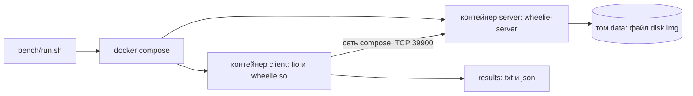

# Стенд для замеров

Как мерить на другом железе и как читать результаты, написано в
[methodology.md](methodology.md); здесь о самом стенде и скриптах.

Стенд — это два контейнера на одной docker-сети: сервер (`wheelie-server`) и
клиент (fio с движком `wheelie.so`, см. [fio.md](fio.md)). Между ними настоящий
сетевой стек, а файл сервера лежит на томе docker, то есть это настоящий файл
на настоящем диске.



## Запуск

Нужен docker с compose; образы собираются сами при первом запуске (сборка
проекта и fio из подмодуля идёт внутри образа, поэтому подмодуль должен быть
получен: `git submodule update --init --depth 1`).

```
bench/run.sh --mode randread --bs 4k --depth 16 --numjobs 1 --backend uring
```

Если вы не в группе `docker`, скрипту можно сказать `DOCKER="sudo docker"`.
После прогона результат fio печатается в консоль, а в `results/` кладутся
`<имя>.txt` (вывод fio), `<имя>.json` (для сравнения прогонов) и
`<имя>.server` (стартовая строка сервера: вариант, потоки, глубина очереди и
`O_DIRECT` или `buffered`, с которыми он был запущен).

| Опция           | По умолчанию                               | Смысл                                                        |
|-----------------|--------------------------------------------|--------------------------------------------------------------|
| `--bs`          | `4k`                                       | размер блока (`4k`, `1m`)                                    |
| `--mode`        | `randread`                                 | `randread`, `randwrite`, `read`, `write`, `randrw`           |
| `--depth`       | `16`                                       | запросов в полёте на задание fio, суммарно по его соединениям |
| `--numjobs`     | `1`                                        | заданий fio, у каждого своё соединение                       |
| `--queues`      | `1`                                        | соединений у каждого задания, по ним раскладываются его запросы |
| `--sync 0\|1`   | `1`                                        | 1 — запись, надёжная к моменту ответа (`WHEELIE_FLAG_SYNC`); чтение от него не зависит |
| `--backend`     | `uring`                                    | `libc`, `alibc` или `uring`: у сервера, и у клиента тоже, если не дан `--client-backend` |
| `--multishot`   | выключен                                   | приём одним multishot recv у сервера, и у клиента тоже, если у него бэкенд сервера |
| `--client-backend` | как `--backend`                         | бэкенд клиента, если он не тот, что у сервера                |
| `--client-multishot 0\|1` | как `--multishot` при том же бэкенде, иначе `0` | multishot у клиента; только для `uring` |
| `--direct 0\|1` | `1`                                        | сервер открывает файл с `O_DIRECT`                           |
| `--data disk\|tmpfs\|device` | `disk`                       | где лежит файл сервера: на томе диска, в памяти (`tmpfs`) без диска под нагрузкой, или на блочном устройстве `WHEELIE_DEVICE` без файловой системы |
| `--threads`     | по числу ядер, которые видит сервер        | потоков сервера, в каждом свой реактор                       |
| `--runtime`     | `10` секунд                                | замеряемое время                                             |
| `--ramp`        | `3` секунды                                | разгон перед замером: fio его отбрасывает                    |
| `--size`        | `1g`                                       | какую часть файла читать и писать (сам файл не меньше 2 ГиБ) |
| `--complete-max` | `1` (fio)                                 | сколько готовых завершений fio может забрать за один вызов; минимальное число остаётся 1 |
| `--complete-min` | `1` (fio)                                 | сколько завершений fio ждёт перед возвратом; 0 разрешает опрос без ожидания |
| `--submit-batch` | `1` (fio)                                 | сколько запросов fio подаёт за одну пачку                    |
| `--fio-arg`     | нет                                        | ещё один аргумент fio, например `--fio-arg --norandommap`; можно повторять |
| `--profile`     | выключен                                   | записать сервер и fio через `perf` и сохранить доли слоёв пути запроса в `<имя>.profile.json` (см. «Куда уходит время») |
| `--profile-window` | `15` секунд                             | сколько писать профиль; не больше `--runtime` минус 2 |
| `--submit URL`  | нет                                        | отправить результат на сервер результатов после прогона (см. «Отправка результатов») |
| `--server-cpus` | все                                        | разрешённые CPU контейнера сервера, например `8-11`          |
| `--client-cpus` | все                                        | разрешённые CPU контейнера клиента; задания fio распределяются по ним с политикой `split`, например `12-19` |
| `--name`        | собирается из параметров                   | имя файлов результата                                        |
| `--out`         | `results`                                  | каталог результатов                                          |
| `--no-build`    | образы собираются                          | не собирать образы                                           |
| `--keep`        | контейнеры останавливаются                 | не останавливать контейнеры после прогона                    |

Вывод fio сохраняется в двух файлах: `<имя>.json` (числа) и `<имя>.txt`
(текст, который читает человек). В текст попадает и ход прогона: fio печатает его
раз в секунду (`--eta=always --eta-newline=1`), строками вида
`Jobs: 8 (f=8): [w(8)][50.0%][w=119MiB/s][w=30.5k IOPS][eta 00m:15s]`, так что по
тексту видно, как шла скорость, а не только итог. Этот же текст уходит на сервер
результатов и показывается на странице результата.

Имя по умолчанию выглядит так: `randread_bs4k_qd16_nj1_uring_sync1` (режим,
размер блока, глубина, число заданий, бэкенд, `_ms` для multishot, `sync`).

Без аргументов скрипт делает случайное чтение блоками по 4 КиБ с глубиной 16
одним соединением на бэкенде `uring` с `O_DIRECT` и `--sync 1`: 3 секунды
разгона и 10 секунд замера.

Для повторяемого сравнения можно ограничить CPU и разрешить fio забирать
сразу несколько готовых завершений:

```
bench/run.sh --mode randread --depth 16 --numjobs 8 --threads 4 \
    --backend uring --multishot --server-cpus 8-11 --client-cpus 12-19 \
    --complete-max 16 --runtime 60 --ramp 5 --out results/pinned
```

Списки CPU подбираются по топологии своей машины. Потоки сервера могут
перемещаться внутри разрешённого набора; это не индивидуальная привязка
каждого потока. Не ставьте клиент и сервер на SMT-потоки одного физического
ядра, если хотите выделить им отдельные ядра. При `--threads` задавайте
число потоков с учётом выбранного набора CPU. Для варианта без multishot
используйте те же CPU и параметры fio, отдельный каталог результатов.
Параметры контейнеров сохраняются рядом с результатом в `<имя>.settings`,
а настройки fio — в его JSON. `--complete-max` не меняет ни глубину очереди,
ни минимальное число ожидаемых завершений; его влияние надо измерять.
Для одного задания с несколькими соединениями отдельно проверьте и подачу
пачками, например `--depth 128 --queues 4 --submit-batch 16
--complete-min 16 --complete-max 128`. Увеличение `--complete-min` меняет
ожидание и может повысить задержку: сравнивайте не только IOPS, но и p95.

Бэкенд и multishot по умолчанию выбираются для обеих сторон сразу: так варианты
(libc, libc с потоками, io_uring, io_uring multishot) сравниваются целиком, а не
по половинке. `--client-backend` и `--client-multishot` дают клиенту другой
бэкенд, чем у сервера. Вариантом результата остаётся вариант сервера (в таблице
`bench/report.py` и на сервере результатов), а клиент к имени файла результата
добавляется как `_client-<бэкенд>`, чтобы такие прогоны не затирали обычные в
одном каталоге. Если клиент такой же, как сервер, в отправляемом результате
о клиенте ничего нет.

## Матрица замеров

`bench/matrix.sh` прогоняет **все варианты на одном и том же наборе нагрузок**,
складывает результаты в один каталог и делает из них таблицу и график:

```
bench/matrix.sh
```

Варианты: `libc`, `alibc`, `uring` и `uring-ms` (`uring` с multishot). Нагрузки,
каждая на каждом варианте (40 прогонов, каждый 15 секунд после разгона 5; `--runtime` и `--ramp` меняют это); таблица отсортирована по блоку, глубине, числу
заданий и режиму:

| Имя                   | Режим       | Блок | Глубина | Заданий | Зачем |
|-----------------------|-------------|------|---------|---------|-------|
| `randread_qd1_nj1`    | `randread`  | 4k   | 1       | 1       | читает по одному запросу: механизм почти не влияет, видна цена передачи между потоками у `alibc` |
| `randwrite_qd1_nj1`   | `randwrite` | 4k   | 1       | 1       | пара к чтению на той же глубине: что даёт запись с `sync=1` |
| `seqread_4k_qd1_nj1`  | `read`      | 4k   | 1       | 1       | пара к журналу: отделяет цену записи от цены глубины 1 |
| `seqwrite_4k_qd1_nj1` | `write`     | 4k   | 1       | 1       | коммит журнала: один небольшой запрос за раз, важна задержка |
| `randread_qd16_nj1`   | `randread`  | 4k   | 16      | 1       | одно соединение и глубокая очередь: где io_uring отличается от libc сильнее всего |
| `randwrite_qd16_nj1`  | `randwrite` | 4k   | 16      | 1       | то же для записи с `sync=1` |
| `randread_qd16_nj8`   | `randread`  | 4k   | 16      | 8       | много соединений: libc догоняет параллелизмом, нагрузку ограничивает диск |
| `randwrite_qd16_nj8`  | `randwrite` | 4k   | 16      | 8       | то же для записи: сервер выходит к потолку диска |
| `seqread_1m_nj4`      | `read`      | 1m   | 4       | 4       | большие блоки, пропускная способность, как у объектного хранилища |
| `seqwrite_1m_nj4`     | `write`     | 1m   | 4       | 4       | то же для записи |

Нагрузки идут в том порядке, в каком они в таблице (список `LOADS` в
`bench/matrix.sh`). Варианты одной нагрузки идут подряд, в случайном порядке,
который для каждой нагрузки свой: первый прогон после тяжёлой нагрузки немного
медленнее, и что-то может прогреваться, так что первым не должен быть всегда один и
тот же вариант. Только в первой нагрузке первыми идут `alibc` и `uring`, в
случайном порядке между собой: первая точка графика, который сравнивает их по
умолчанию (`--submit` отправляет каждый результат сразу после замера), появляется
после двух прогонов. Зерно порядка печатается
(`== order of the variants: --seed N`), а `--seed N` повторяет порядок.

| Опция        | По умолчанию                         | Смысл                                  |
|--------------|--------------------------------------|----------------------------------------|
| `--out`      | `results/matrix-ДАТА-ВРЕМЯ`          | каталог результатов                    |
| `--variants` | `"alibc uring libc uring-ms"`        | какие варианты прогонять; порядок это порядок первой нагрузки |
| `--dry-run`  | выключен                             | только показать, что было бы запущено  |
| `--no-build` | образы собираются                    | не собирать образы                     |

Всё остальное (`--runtime`, `--ramp`, `--direct`, `--sync`, `--threads`,
`--size`) передаётся в `bench/run.sh` для каждого прогона. Прогон, у которого в
каталоге уже есть результат, не повторяется, поэтому прерванную матрицу можно
запустить ещё раз с тем же `--out`, и она продолжится. Нагрузки идут снаружи,
а варианты внутри, так что результаты одной нагрузки получены в близкое время.

## Таблица и график

`bench/report.py` делает таблицу и график из каталога результатов (или из
отдельных JSON); `matrix.sh` вызывает его сам в конце, для таблицы и для графика
`alibc-vs-uring.svg` (по горизонтали `alibc`, по вертикали `uring`: потоки `alibc`
это то, что заменяет кольцо):

```
bench/report.py results/matrix-… --ratio
bench/report.py results/matrix-… --baseline alibc --against uring --plot results/matrix-…/alibc-vs-uring.svg
bench/report.py results/matrix-… --plot results/matrix-…/libc-vs-others.svg   # libc против остальных
```

`--baseline` выбирает вариант по горизонтали (по умолчанию `libc`), `--against`
список вариантов по вертикали через запятую (по умолчанию все, кроме базового).

Нужен только `python3`, без сторонних пакетов. Вариант результата и нагрузка
берутся из параметров, которые fio записал в JSON, а не из имени файла, поэтому
можно складывать результаты разных запусков; если одна нагрузка измерена
несколько раз, берётся последний запуск.

Число соединений, параметры пакетирования и CPU-привязка разделяют нагрузки
на разные строки: такие результаты нельзя считать повторами одного условия.
Файл `<имя>.settings` храните рядом с JSON, чтобы отчёт учитывал настройки
сервера, которых нет в выводе fio. Прогоны с ненулевым `jobs[0].error`
исключаются из отчёта.

**Таблица:** строка на нагрузку, столбец на вариант, ячейка `IOPS / MiB/s /
stddev%`, где `stddev` — разброс IOPS за прогон. Числу с большим разбросом
(выше примерно 20%) верить нельзя. Ключ `--ratio` добавляет вторую таблицу: IOPS
каждого варианта как кратное базового (по умолчанию `libc`, `--baseline`
меняет).

**График** (SVG): точка на нагрузку, по горизонтали значение базового варианта,
по вертикали другого, оси логарифмические. Точка **выше диагонали** — вариант
быстрее базового, **ниже** — медленнее. У мелких блоков числа в IOPS, у крупных
в MiB/s, поэтому у них по панели. У варианта свой цвет и своя форма маркера,
подписаны два самых далёких от диагонали случая, остальные числа видны в
подсказке над точкой и в таблице. График светлый и тёмный по настройке
системы; рисуется без внешних зависимостей. Если значения двух вариантов
почти равны, их маркеры налезают друг на друга: это не ошибка, а
подтверждение, что они близки.

## Куда уходит время

`--profile` записывает `perf record` процесс сервера и процесс fio (хост видит
их как обычные процессы контейнеров) на `--profile-window` секунд после
разгона. `bench/layers.py` превращает запись в доли циклов по слоям пути
запроса:

| слой        | что в него входит                                                    |
|-------------|----------------------------------------------------------------------|
| `network`   | TCP/IP, netfilter, мост, слой сокетов                                |
| `copies`    | копии данных между памятью процесса и ядром                          |
| `storage`   | файловая система, блочный слой, драйвер диска                        |
| `io_uring`  | само кольцо                                                          |
| `scheduler` | планировщик, ожидания, блокировки                                    |
| `code`      | код программы и libc                                                 |
| `other`     | остальное ядро: системные вызовы, память, прерывания, таймеры        |

Слой определяется по имени символа и по объекту, в котором он лежит, поэтому
доли это оценка: ими хорошо сравнивать два прогона на одной машине, а точными
считать их нельзя. Рядом считаются **циклы сервера на запрос**: циклы процесса
за окно, делённые на число запросов за то же время (по IOPS прогона).

`perf` нужны права: скрипт вызывает его через `sudo -n`, если он запущен не от
root. Профиль есть только на Linux: на macOS процессы лежат в виртуалке Docker
Desktop, и снаружи их не записать.

```
bench/run.sh --backend uring --mode randwrite --sync 1 --numjobs 8 \
    --runtime 40 --profile --name write_uring
bench/layers.py layers write_uring.server.perf --process wheelie-server
```

## Отправка результатов

`bench/submit.py` отправляет результаты прогонов на сервер результатов
(wheelieresults). Для каждого результата уходит:

- JSON fio целиком и его текстовый вывод (`<имя>.txt`): текст это то, что читает
  человек, сервер показывает его, а JSON нужен для чисел;
- параметры запуска: опции, которые записал fio, настройки стенда
  (`<имя>.settings`) и строка, которую сервер напечатал при старте;
- параметры машины (на Mac это параметры Linux в Docker Desktop, где работает
  стенд: ядро, число ядер и память виртуалки, а сам Mac записан в `os`): ядро, процессор, память, диски, сетевые карты,
  виртуализация, docker и профиль частоты процессора: governor cpufreq, драйвер,
  предпочтение энергии, boost, диапазон частот. Это ответ на вопрос «энергосбережение
  или производительность»: на `powersave` частота плавает, и числа хуже и шумнее.
  В виртуальной машине этих данных нет. На Mac частоту не выбирают, а режим питания
  говорит `pmset`: низкое энергопотребление (`governor low-power`), высокая мощность
  (`high-power`) или автоматический режим, и работает ли Mac от сети или от батареи;
- профиль, если рядом лежит `<имя>.profile.json` (`--profile`).

Клиент это случайный номер, который скрипт создаёт при первом запуске и хранит в
`~/.local/state/wheeliestor/client-id`: по нему находятся результаты именно
этой машины. Имя хоста машину не покидает, уходит только его хеш. Сервер
отвечает именем, придуманным по номеру (например `swift-otter-3f2a`), и скрипт
печатает его вместе со ссылкой на ваши результаты.

Сервер принимает результат с токеном. Скрипт получает токен по коду, который
записан в нём самом (`PUBLIC_CODE` в `bench/submit.py`); токен живёт пару часов,
и скрипт его нигде не хранит. Код не секрет: он говорит серверу, с какой версией
скрипта тот разговаривает. Когда владелец сервера меняет код у себя, скрипты со
старым кодом перестают принимать, и их нужно обновить (скрипт так и пишет).
Сервер проверяет, что результат подходит под схему и согласован
(fio с параметрами запуска, пропускная способность с IOPS и размером блока,
задержка с числом запросов в полёте, время прогона с запрошенным), и замедляет
тех, кто шлёт слишком часто: скрипт ждёт столько, сколько ему скажут.

```
export WHEELIE_RESULTS_URL=http://results.example:8080

# после каждого прогона
bench/run.sh --backend uring --mode randread --submit "$WHEELIE_RESULTS_URL"

# готовые результаты, целым каталогом
bench/submit.py results/matrix

# посмотреть, что уйдёт, ничего не отправляя
bench/submit.py --dry-run results/matrix
```

Имя можно узнать, ничего не отправляя, и до первого прогона:

```
bench/submit.py --whoami --url http://results.example:8080
```

`bench/run.sh --submit` и `bench/matrix.sh --submit` печатают его перед первым
прогоном (у матрицы вывод каждого прогона уходит в `run.log`, поэтому имя
печатается один раз, после сборки образов и прямо перед первым прогоном, чтобы
его не унёс вывод сборки). С этим именем или ссылкой из той же строки
можно найти себя на странице результатов, не дожидаясь первой отправки.

Результат, который не удалось отправить, остаётся в каталоге: прогон от этого
не проваливается, и его можно отправить позже.

## Подводные камни

- **io_uring в контейнере.** Профиль seccomp по умолчанию не пропускает
  системные вызовы io_uring: без `seccomp:unconfined` (он задан в
  `docker-compose.yml`) сервер с бэкендом `uring` не запустится, а запрос на
  создание кольца вернёт `Operation not permitted`.
- **Память колец io_uring.** В каждом потоке сервера своё кольцо. Стенд
  задаёт контейнерам `memlock` 64 МиБ: обычного лимита 8 МиБ может не
  хватить при большом числе потоков, и сервер завершится с `Cannot allocate
  memory`, даже если свободной RAM много. Этот лимит не резервирует память;
  он разрешает закрепить её в пределах указанного размера.
- **`--sync 1` и `O_DIRECT`: что именно гарантируется.** `--sync 1` просит сервер
  писать с `RWF_DSYNC`: запрос завершается, когда данные дошли до устойчивого
  хранения. С `O_DIRECT` запись идёт мимо кэша страниц прямо в устройство, а флаг
  заставляет ядро дождаться, пока данные не лягут в устойчивую память (FUA или
  сброс кэша устройства). Без `O_DIRECT` (`--direct 0`) данные сначала попадают в
  кэш страниц, но `RWF_DSYNC` не даёт ответить, пока ядро не записало их на
  устройство и не сбросило его кэш: гарантия та же, хотя путь длиннее (лишняя
  копия в кэш, writeback). Без `--sync` запись возвращается сразу, как только
  данные попали в кэш страниц (без `O_DIRECT`) или в устройство, у которого может
  быть свой кэш (с `O_DIRECT`): такой ответ ничего не гарантирует. Поэтому по
  умолчанию стоит и то и другое: `O_DIRECT` убирает кэш страниц из измерения, а
  `--sync 1` делает запись настоящей.
- **`O_DIRECT`.** По умолчанию он включён, и вот почему: без него чтение идёт
  через кэш страниц, то есть результат зависит от того, что в нём лежит. Сразу
  после заполнения файл целиком в кэше, и случайные чтения измеряют память; когда
  кэш остыл, они идут с диска через упреждающее чтение, медленнее и с очень
  большим разбросом (на одной машине такие прогоны давали `stddev` больше 100%).
  С `O_DIRECT` кэша нет, и число значит одно и то же от прогона к прогону. Это
  и режим, в котором работает хранилище (у клиента свой кэш, дублировать его на
  сервере незачем). Заодно только с ним асинхронная запись io_uring идёт без
  помощи потоков ядра: буферизованная запись всё равно уходит в рабочие потоки
  (io-wq), и сравнение превращается в «потоки против потоков». Цена: запросы
  должны быть выровнены так, как требует `O_DIRECT` (блок меньше 512 байт получит
  `-EINVAL`), а если файловая система тома его не принимает, сервер откажется
  стартовать, и тогда нужно `--direct 0`.
- **Файл в памяти.** `--data tmpfs` подключает `docker-compose.tmpfs.yml`: том
  сервера становится `tmpfs` на 4 ГиБ, и под нагрузкой нет диска. Так меряется
  то, что остаётся от пути запроса без диска: потолок дают процессор сервера и
  клиента. Скрипт сверяет тип файловой системы тома (`stat -f`) и не продолжает,
  если файл не в памяти. Том в памяти исчезает вместе с контейнерами, и сервер
  заполняет файл заново при каждом старте. Если `O_DIRECT` на `tmpfs` не
  принимается, сервер откажется стартовать, и тогда нужно `--direct 0`.
- **Блочное устройство.** `--data device` отдаёт серверу блочное устройство из
  переменной `WHEELIE_DEVICE` (`docker-compose.device.yml`): под нагрузкой нет
  ни файловой системы, ни тома. Так меряется настоящий накопитель. Устройство
  **перезаписывается** (в диапазоне `--size` от начала), поэтому нужно такое,
  которым ничто больше не пользуется, например свободный раздел NVMe. Скрипт
  отказывается стартовать, если `WHEELIE_DEVICE` не блочное устройство. Сервер
  не заполняет его: читаются те данные, что там уже есть. Состояние накопителя
  влияет на цифры: после записи чтение 4k может идти заметно быстрее, чем
  через четверть часа, поэтому состояние нужно записывать вместе с результатом.
- **Файл заполняется нулями один раз** при создании тома: у файла без блоков
  чтение не читает диск.
- **Docker на macOS.** Файл лежит на виртуализированном диске внутри виртуалки,
  и абсолютные цифры нельзя сравнивать с настоящим диском, зато относительное
  сравнение бэкендов на одном и том же стенде остаётся честным.
- **Как не наврать себе.** Смотрите на разброс (`stddev` рядом с IOPS; выше
  примерно 20% — плохой знак) и на `--ramp`: он должен быть дольше, чем время до
  «обрыва» записи (когда кэш диска или тонкая аллокация закончились), иначе
  обрыв попадёт в замер.
- **Каким вариантом запущен сервер**, видно по строке `== server:` в начале
  вывода: это то, что он сам напечатал при старте (бэкенд, multishot, потоки,
  глубина очереди, `O_DIRECT` или `buffered`), а не то, что просили. Скрипт
  сверяет её с запросом и останавливается, если они расходятся: настройки идут
  в compose через файл, потому что `sudo docker` не получает окружение скрипта.
- **`--queue-depth` сервера** скрипт считает сам: на соединение приходится один
  recv и по операции на каждый ещё не отправленный ответ, поэтому глубина
  растёт с `--numjobs` и `--depth`.
