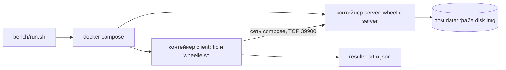

# Стенд для замеров

Как мерить на другом железе и как читать результаты, написано в
[methodology.md](methodology.md); здесь о самом стенде и скриптах.

Стенд — это два контейнера на одной docker-сети: сервер (`wheelie-server`) и
клиент (fio с движком `wheelie.so`, см. [fio.md](fio.md)). Между ними настоящий
сетевой стек, а файл сервера лежит на томе docker, то есть это настоящий файл
на настоящем диске.



## Запуск

Нужен docker с compose; образы собираются сами при первом запуске (сборка
проекта и fio из подмодуля идёт внутри образа, поэтому подмодуль должен быть
получен: `git submodule update --init --depth 1`).

```
bench/run.sh --mode randread --bs 4k --depth 16 --numjobs 1 --backend uring
```

Если вы не в группе `docker`, скрипту можно сказать `DOCKER="sudo docker"`.
После прогона результат fio печатается в консоль, а в `results/` кладутся
`<имя>.txt` (вывод fio), `<имя>.json` (для сравнения прогонов) и
`<имя>.server` (стартовая строка сервера: вариант, потоки, глубина очереди и
`O_DIRECT` или `buffered`, с которыми он был запущен).

| Опция           | По умолчанию                               | Смысл                                                        |
|-----------------|--------------------------------------------|--------------------------------------------------------------|
| `--bs`          | `4k`                                       | размер блока (`4k`, `1m`)                                    |
| `--mode`        | `randread`                                 | `randread`, `randwrite`, `read`, `write`, `randrw`           |
| `--depth`       | `16`                                       | запросов в полёте на соединении                              |
| `--numjobs`     | `1`                                        | заданий fio, у каждого своё соединение                       |
| `--sync 0\|1`   | `0`                                        | 1 — запись, надёжная к моменту ответа (`WHEELIE_FLAG_SYNC`)  |
| `--backend`     | `uring`                                    | `libc`, `alibc` или `uring`: **и у сервера, и у клиента**    |
| `--multishot`   | выключен                                   | приём одним multishot recv, **у сервера и у клиента**        |
| `--direct 0\|1` | `1`                                        | сервер открывает файл с `O_DIRECT`                           |
| `--threads`     | по числу ядер, которые видит сервер        | потоков сервера, в каждом свой реактор                       |
| `--runtime`     | `10` секунд                                | замеряемое время                                             |
| `--ramp`        | `3` секунды                                | разгон перед замером: fio его отбрасывает                    |
| `--size`        | `1g`                                       | какую часть файла читать и писать (сам файл не меньше 2 ГиБ) |
| `--name`        | собирается из параметров                   | имя файлов результата                                        |
| `--out`         | `results`                                  | каталог результатов                                          |
| `--no-build`    | образы собираются                          | не собирать образы                                           |
| `--keep`        | контейнеры останавливаются                 | не останавливать контейнеры после прогона                    |

Имя по умолчанию выглядит так: `randread_bs4k_qd16_nj1_uring_sync0` (режим,
размер блока, глубина, число заданий, бэкенд, `_ms` для multishot, `sync`).

Без аргументов скрипт делает случайное чтение блоками по 4 КиБ с глубиной 16
одним соединением на бэкенде `uring` с `O_DIRECT`: 3 секунды разгона и 10
секунд замера.

Бэкенд и multishot выбираются для обеих сторон сразу: так варианты (libc, libc
с потоками, io_uring, io_uring multishot) сравниваются целиком, а не по
половинке.

## Матрица замеров

`bench/matrix.sh` прогоняет **все варианты на одном и том же наборе нагрузок**,
складывает результаты в один каталог и делает из них таблицу и график:

```
bench/matrix.sh --runtime 10 --ramp 3
```

Варианты: `libc`, `alibc`, `uring` и `uring-ms` (`uring` с multishot). Нагрузки,
каждая на каждом варианте (32 прогона):

| Имя                  | Режим       | Блок | Глубина | Заданий |
|----------------------|-------------|------|---------|---------|
| `randread_qd1_nj1`   | `randread`  | 4k   | 1       | 1       |
| `randread_qd16_nj1`  | `randread`  | 4k   | 16      | 1       |
| `randread_qd16_nj8`  | `randread`  | 4k   | 16      | 8       |
| `randwrite_qd1_nj1`  | `randwrite` | 4k   | 1       | 1       |
| `randwrite_qd16_nj1` | `randwrite` | 4k   | 16      | 1       |
| `randwrite_qd16_nj8` | `randwrite` | 4k   | 16      | 8       |
| `seqread_1m_nj4`     | `read`      | 1m   | 4       | 4       |
| `seqwrite_1m_nj4`    | `write`     | 1m   | 4       | 4       |

| Опция        | По умолчанию                         | Смысл                                  |
|--------------|--------------------------------------|----------------------------------------|
| `--out`      | `results/matrix-ДАТА-ВРЕМЯ`          | каталог результатов                    |
| `--variants` | `"libc alibc uring uring-ms"`        | какие варианты прогонять               |
| `--dry-run`  | выключен                             | только показать, что было бы запущено  |
| `--no-build` | образы собираются                    | не собирать образы                     |

Всё остальное (`--runtime`, `--ramp`, `--direct`, `--sync`, `--threads`,
`--size`) передаётся в `bench/run.sh` для каждого прогона. Прогон, у которого в
каталоге уже есть результат, не повторяется, поэтому прерванную матрицу можно
запустить ещё раз с тем же `--out`, и она продолжится. Нагрузки идут снаружи,
а варианты внутри, так что результаты одной нагрузки получены в близкое время.

## Таблица и график

`bench/report.py` делает таблицу и график из каталога результатов (или из
отдельных JSON); `matrix.sh` вызывает его сам в конце:

```
bench/report.py results/matrix-… --ratio --plot results/matrix-…/libc-vs-others.svg
```

Нужен только `python3`, без сторонних пакетов. Вариант результата и нагрузка
берутся из параметров, которые fio записал в JSON, а не из имени файла, поэтому
можно складывать результаты разных запусков; если одна нагрузка измерена
несколько раз, берётся последний запуск.

**Таблица:** строка на нагрузку, столбец на вариант, ячейка `IOPS / MiB/s /
stddev%`, где `stddev` — разброс IOPS за прогон. Числу с большим разбросом
(выше примерно 20%) верить нельзя. Ключ `--ratio` добавляет вторую таблицу: IOPS
каждого варианта как кратное базового (по умолчанию `libc`, `--baseline`
меняет).

**График** (SVG): точка на нагрузку, по горизонтали значение базового варианта,
по вертикали другого, оси логарифмические. Точка **выше диагонали** — вариант
быстрее базового, **ниже** — медленнее. У мелких блоков числа в IOPS, у крупных
в MiB/s, поэтому у них по панели. У варианта свой цвет и своя форма маркера,
подписаны два самых далёких от диагонали случая, остальные числа видны в
подсказке над точкой и в таблице. График светлый и тёмный по настройке
системы; рисуется без внешних зависимостей. Если значения двух вариантов
почти равны, их маркеры налезают друг на друга: это не ошибка, а
подтверждение, что они близки.

## Подводные камни

- **io_uring в контейнере.** Профиль seccomp по умолчанию не пропускает
  системные вызовы io_uring: без `seccomp:unconfined` (он задан в
  `docker-compose.yml`) сервер с бэкендом `uring` не запустится, а запрос на
  создание кольца вернёт `Operation not permitted`.
- **`O_DIRECT`.** По умолчанию он включён, и вот почему: без него чтение идёт
  через кэш страниц, то есть результат зависит от того, что в нём лежит. Сразу
  после заполнения файл целиком в кэше, и случайные чтения измеряют память; когда
  кэш остыл, они идут с диска через упреждающее чтение, медленнее и с очень
  большим разбросом (на одной машине такие прогоны давали `stddev` больше 100%).
  С `O_DIRECT` кэша нет, и число значит одно и то же от прогона к прогону. Это
  и режим, в котором работает хранилище (у клиента свой кэш, дублировать его на
  сервере незачем). Заодно только с ним асинхронная запись io_uring идёт без
  помощи потоков ядра: буферизованная запись всё равно уходит в рабочие потоки
  (io-wq), и сравнение превращается в «потоки против потоков». Цена: запросы
  должны быть выровнены так, как требует `O_DIRECT` (блок меньше 512 байт получит
  `-EINVAL`), а если файловая система тома его не принимает, сервер откажется
  стартовать, и тогда нужно `--direct 0`.
- **Файл заполняется нулями один раз** при создании тома: у файла без блоков
  чтение не читает диск.
- **Docker на macOS.** Файл лежит на виртуализированном диске внутри виртуалки,
  и абсолютные цифры нельзя сравнивать с настоящим диском, зато относительное
  сравнение бэкендов на одном и том же стенде остаётся честным.
- **Как не наврать себе.** Смотрите на разброс (`stddev` рядом с IOPS; выше
  примерно 20% — плохой знак) и на `--ramp`: он должен быть дольше, чем время до
  «обрыва» записи (когда кэш диска или тонкая аллокация закончились), иначе
  обрыв попадёт в замер.
- **Каким вариантом запущен сервер**, видно по строке `== server:` в начале
  вывода: это то, что он сам напечатал при старте (бэкенд, multishot, потоки,
  глубина очереди, `O_DIRECT` или `buffered`), а не то, что просили. Скрипт
  сверяет её с запросом и останавливается, если они расходятся: настройки идут
  в compose через файл, потому что `sudo docker` не получает окружение скрипта.
- **`--queue-depth` сервера** скрипт считает сам: на соединение приходится один
  recv и по операции на каждый ещё не отправленный ответ, поэтому глубина
  растёт с `--numjobs` и `--depth`.
