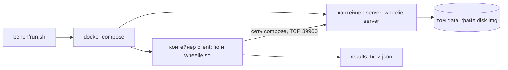

# Стенд для замеров

Стенд — это два контейнера на одной docker-сети: сервер (`wheelie-server`) и
клиент (fio с движком `wheelie.so`, см. [fio.md](fio.md)). Между ними настоящий
сетевой стек, а файл сервера лежит на томе docker, то есть это настоящий файл
на настоящем диске.



## Запуск

Нужен docker с compose; образы собираются сами при первом запуске (сборка
проекта и fio из подмодуля идёт внутри образа, поэтому подмодуль должен быть
получен: `git submodule update --init --depth 1`).

```
bench/run.sh --mode randread --bs 4k --depth 16 --numjobs 1 --backend uring
```

Если вы не в группе `docker`, скрипту можно сказать `DOCKER="sudo docker"`.
После прогона результат fio печатается в консоль, а в `results/` кладутся
`<имя>.txt` (вывод fio) и `<имя>.json` (для сравнения прогонов).

| Опция           | По умолчанию                               | Смысл                                                        |
|-----------------|--------------------------------------------|--------------------------------------------------------------|
| `--bs`          | `4k`                                       | размер блока (`4k`, `1m`)                                    |
| `--mode`        | `randread`                                 | `randread`, `randwrite`, `read`, `write`, `randrw`           |
| `--depth`       | `16`                                       | запросов в полёте на соединении                              |
| `--numjobs`     | `1`                                        | заданий fio, у каждого своё соединение                       |
| `--sync 0\|1`   | `0`                                        | 1 — запись, надёжная к моменту ответа (`WHEELIE_FLAG_SYNC`)  |
| `--backend`     | `uring`                                    | `libc`, `alibc` или `uring`: **и у сервера, и у клиента**    |
| `--multishot`   | выключен                                   | приём одним multishot recv, **у сервера и у клиента**        |
| `--direct 0\|1` | `1`                                        | сервер открывает файл с `O_DIRECT`                           |
| `--threads`     | по числу ядер, которые видит сервер        | потоков сервера, в каждом свой реактор                       |
| `--runtime`     | `10` секунд                                | замеряемое время                                             |
| `--ramp`        | `3` секунды                                | разгон перед замером: fio его отбрасывает                    |
| `--size`        | `1g`                                       | какую часть файла читать и писать (сам файл не меньше 2 ГиБ) |
| `--name`        | собирается из параметров                   | имя файлов результата                                        |
| `--out`         | `results`                                  | каталог результатов                                          |
| `--no-build`    | образы собираются                          | не собирать образы                                           |
| `--keep`        | контейнеры останавливаются                 | не останавливать контейнеры после прогона                    |

Имя по умолчанию выглядит так: `randread_bs4k_qd16_nj1_uring_sync0` (режим,
размер блока, глубина, число заданий, бэкенд, `_ms` для multishot, `sync`).

Без аргументов скрипт делает случайное чтение блоками по 4 КиБ с глубиной 16
одним соединением на бэкенде `uring` с `O_DIRECT`: 3 секунды разгона и 10
секунд замера.

Бэкенд и multishot выбираются для обеих сторон сразу: так варианты (libc, libc
с потоками, io_uring, io_uring multishot) сравниваются целиком, а не по
половинке.

## Пример: матрица замеров

Все бэкенды на типичных нагрузках: мелкие случайные чтения и записи с разной
глубиной очереди и числом соединений, и крупные последовательные.

```
for backend in libc alibc uring; do
  for mode in randread randwrite; do
    bench/run.sh --mode $mode --bs 4k --depth 1  --numjobs 1 --backend $backend
    bench/run.sh --mode $mode --bs 4k --depth 16 --numjobs 1 --backend $backend
    bench/run.sh --mode $mode --bs 4k --depth 16 --numjobs 8 --backend $backend
  done
  bench/run.sh --mode read  --bs 1m --depth 4 --numjobs 4 --backend $backend
  bench/run.sh --mode write --bs 1m --depth 4 --numjobs 4 --backend $backend
done
```

И то же с `--multishot` для `uring`. Строка `--sync 1` добавляется к тем из них,
где важна надёжность записи.

## Подводные камни

- **io_uring в контейнере.** Профиль seccomp по умолчанию не пропускает
  системные вызовы io_uring: без `seccomp:unconfined` (он задан в
  `docker-compose.yml`) сервер с бэкендом `uring` не запустится, а запрос на
  создание кольца вернёт `Operation not permitted`.
- **`O_DIRECT`.** По умолчанию он включён, и вот почему: файл заполняется один
  раз и после этого целиком лежит в кэше страниц, поэтому без `O_DIRECT`
  случайные чтения измеряли бы память, а не диск. Это и режим, в котором
  работает хранилище (у клиента свой кэш, дублировать его на сервере незачем).
  Заодно только с ним асинхронная запись io_uring идёт без помощи потоков ядра:
  буферизованная запись всё равно уходит в рабочие потоки (io-wq), и сравнение
  превращается в «потоки против потоков». Цена: запросы должны быть выровнены
  так, как требует `O_DIRECT` (блок меньше 512 байт получит `-EINVAL`), а если
  файловая система тома его не принимает, сервер откажется стартовать, и тогда
  нужно `--direct 0`. Сравнение с `--direct 0` и без него показывает, сколько из
  выигрыша — это просто кэш страниц.
- **Файл заполняется нулями один раз** при создании тома: у файла без блоков
  чтение не читает диск.
- **Docker на macOS.** Файл лежит на виртуализированном диске внутри виртуалки,
  и абсолютные цифры нельзя сравнивать с настоящим диском, зато относительное
  сравнение бэкендов на одном и том же стенде остаётся честным.
- **Как не наврать себе.** Смотрите на разброс (`stddev` рядом с IOPS; выше
  примерно 20% — плохой знак) и на `--ramp`: он должен быть дольше, чем время до
  «обрыва» записи (когда кэш диска или тонкая аллокация закончились), иначе
  обрыв попадёт в замер.
- **`--queue-depth` сервера** скрипт считает сам: на соединение приходится один
  recv и по операции на каждый ещё не отправленный ответ, поэтому глубина
  растёт с `--numjobs` и `--depth`.
