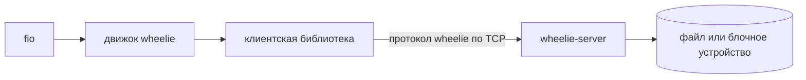
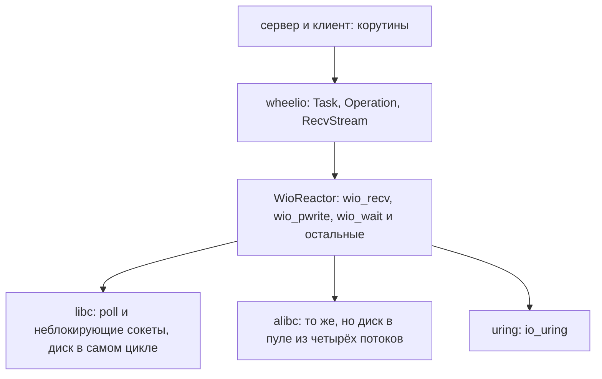
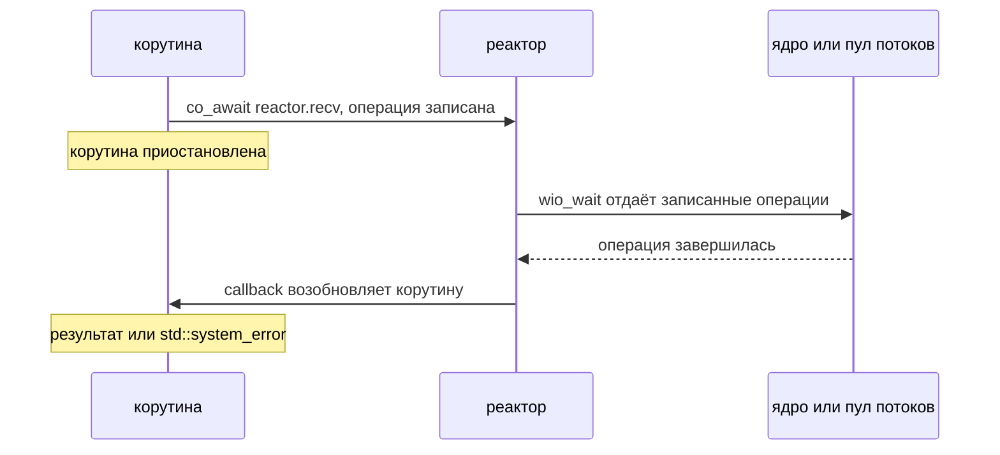
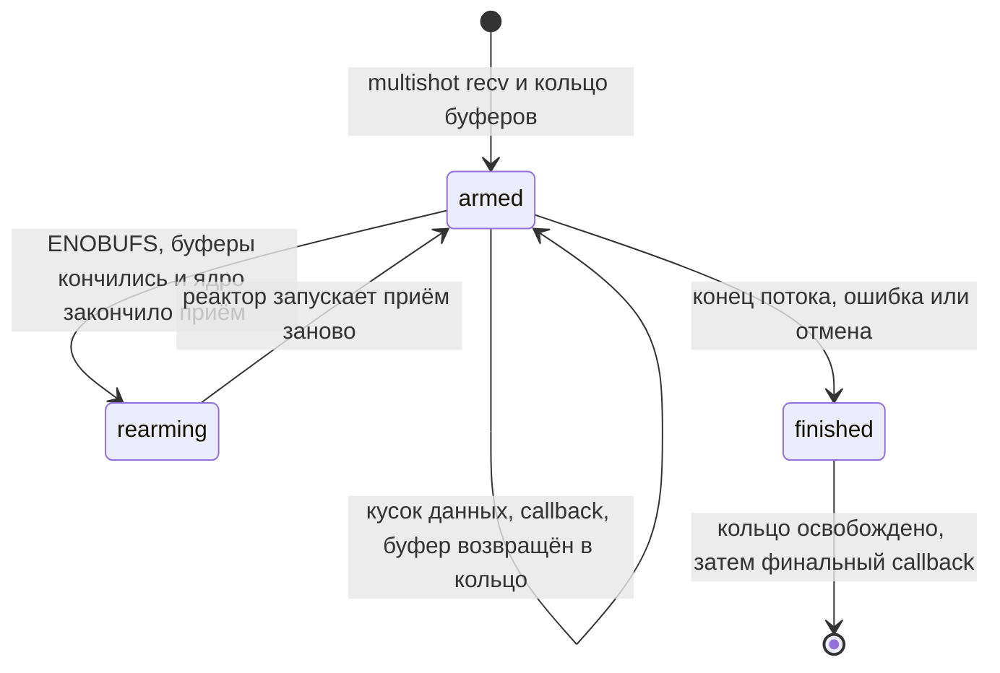
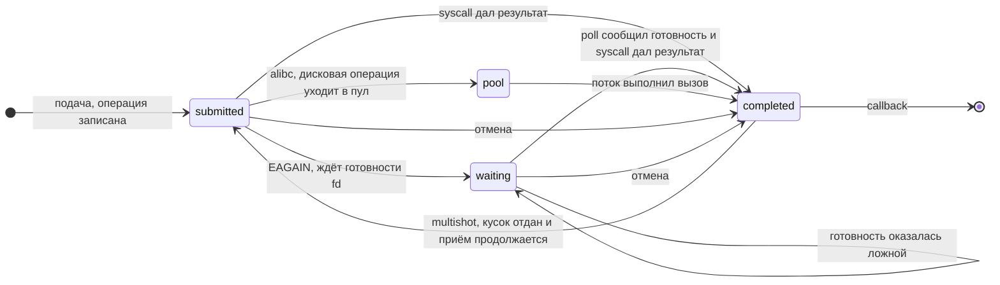
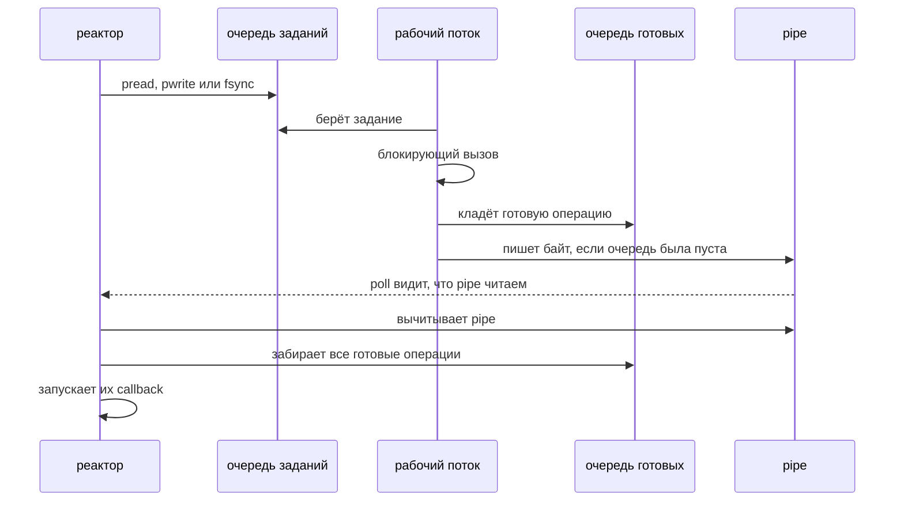
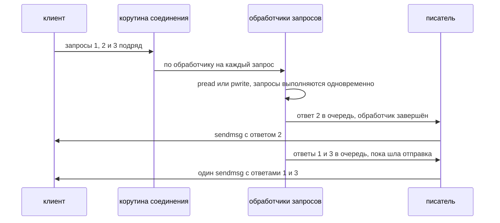
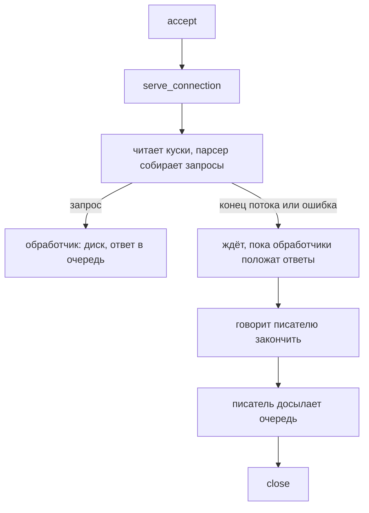
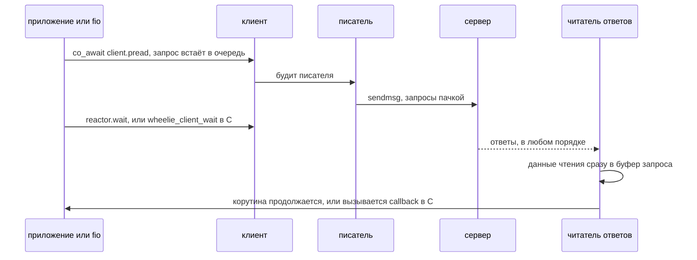
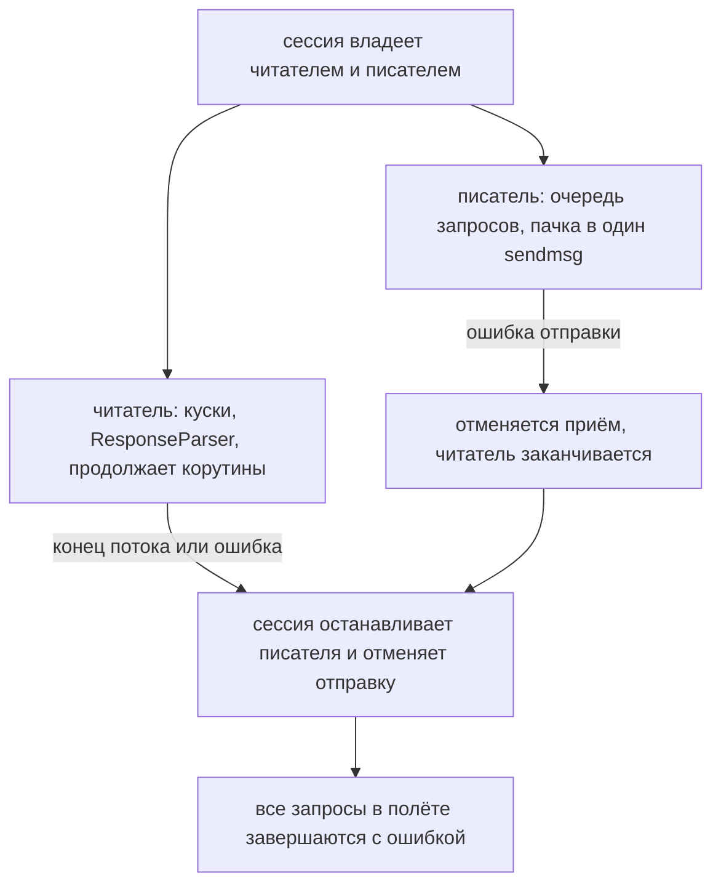

# Дизайн

## Цель

Сравнить libc и io_uring в клиент-серверном приложении, которое передаёт
данные по TCP и хранит их на диске, при этом всё, кроме механизма ввода-вывода,
остаётся неизменным.

## Конвейер

Клиент и сервер пишутся один раз поверх реактора `wheelio`; бэкенд выбирается
во время запуска.

## wheelio

Реактор в стиле completion на C: вызывающий код готовит операцию, реактор её
выполняет, и по завершении вызывается callback. Это родная модель io_uring.
Бэкенды на libc её эмулируют, из-за чего в коде видна разница между
готовностью (`poll()` говорит, что из fd *можно* читать) и завершением
(операция *уже выполнена*).

Где реактор стоит и что под ним:

Бэкенды:

| Бэкенд         | Сокеты                       | Дисковый ввод-вывод                       |
|----------------|------------------------------|-------------------------------------------|
| `libc`         | неблокирующие + `poll()`     | блокирующий вызов прямо в цикле           |
| `alibc`        | неблокирующие + `poll()`     | пул рабочих потоков, завершение через pipe |
| `uring`        | io_uring                     | io_uring                                  |

У `uring` дополнительно есть режим multishot recv с кольцом provided-буферов.

Общая часть реактора проверяет аргументы, считает операции в полёте и
передаёт операцию бэкенду; у бэкенда для каждой операции своя функция
(`WioReactorOps`). Состояние запроса, нужное бэкенду, он хранит сам, поэтому
`uring` готовит SQE прямо из аргументов и ничего не копирует в `WioOp`.

Параметры сервера, не зависящие друг от друга:

- `--backend libc|alibc|uring` (и `--multishot`) — чем выполняется
  ввод-вывод;
- `--threads N` — сколько потоков обслуживают клиентов, в каждом свой реактор
  (multiqueue). Не зависит от бэкенда.

Пул дисковых потоков у `alibc` фиксирован: 4 потока на каждый реактор, и в
`--threads` они не входят.

## Операции и контракт API

Публичный интерфейс — `wheelio/include/wheelio/wheelio.h`. Главные правила:

- **Операция** — структура `WioOp`, которой владеет вызывающий код, обычно она
  встраивается в его собственное состояние запроса. Реактор хранит её адрес и
  ничего не аллоцирует на каждую операцию. Из callback к своему состоянию
  можно добраться через `wio_container_of()`.
- **Время жизни.** `WioOp` и все буферы, с которыми операция была подана, должны
  жить до её последнего callback, в том числе если её отменили: бэкенд может
  читать и писать их до этого момента.
- **Прогресс.** Подача операции только записывает её. Всё выполняется внутри
  `wio_wait(reactor, timeout_ms)`: он отдаёт накопленные операции бэкенду, ждёт
  и вызывает callback для всего завершённого. Callback может подавать новые
  операции, но не может вызывать `wio_wait()`.
- **Результат.** Неотрицательное значение, специфичное для операции, или
  `-errno`. У одиночной операции ровно один callback. У multishot-операции
  callback на каждое событие с флагом `WIO_F_MORE` и один последний без него;
  только после него `WioOp` можно переиспользовать или освободить.
- **Один поток на реактор.** Масштабирование — это несколько реакторов по
  одной на поток, без блокировок.
- **Отмена** `wio_cancel(reactor, target)` не имеет собственного callback: у
  `target` последний callback придёт ровно один раз с `-ECANCELED`, если
  операция не успела завершиться сама. `wio_cancel_fd()` отменяет всё на
  дескрипторе и безопасен, когда ничего нет.
- **Multishot recv** (`wio_recv_multishot`) владеет буферами сам: берёт кольцо
  из `entries` буферов по `entry_size` байт, отдаёт каждый принятый кусок в
  callback и забирает буфер обратно, когда callback вернулся. Данные нужно
  скопировать, если они нужны дольше.

Так выглядит одна операция от подачи до продолжения корутины:

Набор операций первой итерации: `accept`, `connect`, `close`, `recv` (и
multishot), `send`, `sendmsg`, `pread`, `pwrite` (с флагом
`WIO_WRITE_DSYNC`), `fsync`, отмена. `open`, `stat`, `unlink`, registered
files и SEND_ZC пока не входят.

## Бэкенд uring

- Кольцо создаётся с `IORING_SETUP_SUBMIT_ALL` и `IORING_SETUP_COOP_TASKRUN`;
  CQ-кольцо в четыре раза больше глубины `depth` (но не больше 65536), потому
  что multishot-операция кладёт в него много завершений.
- `user_data` каждого запроса — адрес `WioOp`, поэтому на операцию нет ни
  аллокаций, ни таблиц соответствия. Запросы отмены идут с `user_data = 0` и
  в диспетчере пропускаются.
- Если SQ-кольцо заполнено, реактор сам отдаёт накопленное ядру и повторяет
  попытку.
- У multishot recv своё кольцо provided-буферов: дескрипторы и буферы в одном
  `mmap`. Идентификатор группы буферов — 16 бит, поэтому свободные ищутся по
  битовой карте, а не берутся из счётчика: за жизнь сервера соединений может
  быть больше 65536.
- Когда буферы заканчиваются, ядро завершает multishot с `-ENOBUFS`. Реактор
  возвращает уже обработанные буферы в кольцо и заново запускает приём, а
  приложение продолжает получать данные и ничего не замечает.
- Кольцо буферов освобождается до финального callback: callback вправе
  освободить саму операцию.

Жизнь multishot recv с кольцом буферов:

## Бэкенд libc

- Сокеты неблокирующие: `recv`, `send` и `sendmsg` вызываются с
  `MSG_DONTWAIT`, поэтому состояние дескриптора не меняется. Для `accept` и
  `connect` бэкенд сам делает дескриптор неблокирующим: иначе `accept` на
  общем между реакторами слушающем сокете мог бы зависнуть.
- Подача операции только записывает её. В `wio_wait` каждая записанная
  операция сначала пробуется сразу, как в обычном коде, который вызывает
  syscall и вызывает `poll()` лишь при `EAGAIN`. Не готовые встают в ожидание
  и ждут одним `poll()` на всех.
- Диск (`pread`, `pwrite`, `fsync`) и `close` выполняются прямо в цикле
  блокирующими вызовами. Это и есть то, что сравнивается: пока идёт запись с
  `RWF_DSYNC`, цикл не обслуживает ни одного сокета.
- Операция всегда в одном из трёх списков: записана, ждёт fd, готова. Callback
  запускаются отдельной фазой после всех syscall, поэтому внутри них можно
  безопасно отменять и подавать операции.
- Multishot recv эмулируется: после каждого куска операция снова встаёт в
  ожидание. Буфер один (`entry_size`), потому что кусок отдаётся и забывается
  до следующего приёма; `entries` не нужно.

Где операция находится внутри `libc` и `alibc` (в списках реактора):

## Бэкенд alibc

- Это `libc`, у которого дисковые операции (`pread`, `pwrite`, `fsync`)
  выполняет пул из четырёх рабочих потоков, а не сам цикл. Сокеты и `close`
  остаются в цикле. Своё кольцо потоков у каждого реактора, поэтому при
  нескольких реакторах потоков в пуле будет по четыре на каждый.
- Реактор кладёт операцию в очередь заданий пула (мьютекс и condvar), поток
  выполняет блокирующий вызов и кладёт операцию в очередь готовых. Когда эта
  очередь перестаёт быть пустой, поток пишет байт в `pipe`.
- Читающий конец `pipe` стоит в том же `poll()`, что и сокеты, поэтому цикл
  просыпается и от сетевых событий, и от завершения диска. Перед тем как
  забрать очередь готовых, цикл вычитывает `pipe`; худший исход гонки —
  лишнее раннее пробуждение, но не потерянное.
- Операция в пуле не отменяется: системный вызов не прерывается, и она
  завершается со своим результатом (`wio_cancel` на ней только запоминает
  флаг). Для `uring` отмена ещё не начавшейся дисковой операции работает.
- Цена этой схемы и есть предмет сравнения: два захвата мьютекса и
  переключение контекста на каждую операцию, плюс `write` в `pipe` и `read`
  из него на каждую пачку завершений.

Путь дисковой операции через пул:

## Корутины

Тонкий слой C++20 поверх C-интерфейса реактора; реактор и бэкенды он не
меняет. Два заголовка: `wheelio/coro.hpp` (задачи) и `wheelio/reactor.hpp`
(обёртка реактора).

- **`Task<T>`** стартует сразу и работает на стеке вызывающего до первой
  настоящей приостановки. Завершение возвращает управление ожидающему через
  symmetric transfer, поэтому цепочки `co_await` не растят стек.
- **`spawn(task)`** запускает задачу и забывает о ней. Исключение, которое из
  неё вылетело, нельзя бросить сразу: оно возникло внутри callback, то есть
  в C-кадре. Поэтому оно откладывается, и его бросает следующий
  `Reactor::wait()`.
- **`Operation<T>`** — awaitable одной операции. `WioOp` лежит в нём самом, то
  есть на кадре корутины, без аллокаций. Операция может завершиться раньше,
  чем её начали ждать: подать две и дождаться второй первой допустимо. Любая
  ошибка (отказ подачи и ошибка самой операции) — это `std::system_error`.
- **`RecvStream`** — `while (auto chunk = co_await stream.next())` поверх
  multishot recv. Кусок — это окно в буфер реактора, которое возвращается, как
  только корутина снова приостановится, поэтому его нужно использовать или
  скопировать до следующего `co_await`. Если корутина в этот момент ждёт не
  `next()`, приходящие куски копируются и хранятся до следующего вызова;
  отправителя поток не замедляет. Уничтоженный в полёте поток отменяет приём, а
  его состояние освобождается само, когда реактор сообщит о конце приёма.
- **Задача не должна уничтожаться, пока она приостановлена на операции в
  полёте:** операция потом возобновит уже несуществующий кадр. Дождитесь её
  или сначала отмените операцию и дайте ей завершиться.

## Сервер

`wheelie-server` отдаёт файл или блочное устройство по протоколу из
[protocol.md](protocol.md). Он написан один раз на корутинах поверх реактора, а
чем выполняется ввод-вывод, выбирается при запуске.

Что происходит с запросами одного соединения: они выполняются одновременно, а
ответы идут по одному потоку байтов через писателя:

Жизнь соединения от `accept` до `close`:

- **Потоки.** `--threads N` потоков, в каждом свой реактор со своими
  соединениями. Соединения принимает один из них, нулевой, и раздаёт потокам
  по кругу, себя включая: если бы все потоки ждали `accept` на общем
  слушающем сокете, ядро отдавало бы соединения неровно, и у клиента с
  несколькими соединениями часть потоков сервера простаивала бы. Остальным
  потокам номер дескриптора передаётся по `socketpair`: дескрипторы общие на
  весь процесс, поэтому передавать больше нечего. От бэкенда это не зависит.
- **Соединение** — одна корутина `serve_connection`. Она читает куски
  (`--multishot`: один multishot recv, иначе по одному `recv` на кусок) и
  кормит ими `RequestParser`, который собирает запрос прямо в выровненный
  буфер. Запрос запускает собственную задачу и не ждёт её, поэтому несколько
  запросов на одном соединении выполняются одновременно.
- **Ответы мультиплексируются.** Запросы одного соединения выполняются
  одновременно, а поток байтов у него один, и ответ на большое чтение уходит
  не одним `send`. Поэтому ответы не отправляют сами обработчики: каждый
  кладёт готовый ответ в очередь и сразу завершается, а единственная корутина-
  писатель соединения забирает из очереди до 128 ответов и отправляет их одним
  `sendmsg`, у которого `iovec` на заголовок и данные каждого. Если сокет
  принял не всё, остаток досылается следующим `sendmsg`, а границы кадров не
  нарушаются, потому что пишет только один писатель.
- **Пакетирование происходит само собой:** первый ответ уходит сразу, а те,
  что появились, пока он отправлялся, ждут в очереди и уходят вместе. Для 256
  конвейерных чтений 4 КиБ на одном соединении это три вызова `sendmsg` вместо
  256 у `libc` и около 19 вызовов `io_uring_enter` вместо 271 у `uring`.
- **Конец соединения:** корутина ждёт (`WaitGroup`), пока все её запросы
  положат ответы в очередь, говорит писателю, что больше ответов не будет,
  ждёт, пока он отправит остаток, и только потом закрывает дескриптор. Если
  отправка не удалась, ответы выбрасываются, а приём на соединении
  отменяется: отвечать больше некому.
- **Остановка:** реакторы проверяют флаг каждые 100 мс, затем отменяют `accept`
  и все соединения и до 5 секунд ждут, пока в полёте ничего не останется.
- **`--queue-depth`** (по умолчанию 1024) должен покрывать соединения,
  умноженные на глубину очереди клиента: на соединение приходится один recv и по
  операции на каждый ещё не отправленный ответ. При нехватке запрос получает
  ответ `-EBUSY`.

## Клиент

Клиент (`client/`) — это соединения с сервером (по умолчанию одно) и запросы в
полёте на них.
Он написан целиком на корутинах поверх того же реактора, что и сервер, и
бэкенд выбирается при создании. Слоёв два:

- **Корутинный интерфейс** (`client/client.hpp`): `co_await client.pread(...)`
  и `co_await client.pwrite(...)` возвращают число байт. Запрос подаётся в
  момент создания `Client::Request`, а его `WioOp`-подобное состояние лежит в
  самом awaitable, на кадре ждущей корутины, поэтому запрос не стоит
  аллокации. Любая ошибка — это `std::system_error`: при подаче (`EBUSY`,
  `EMSGSIZE`, `EINVAL` или причина обрыва соединения) или из `co_await` (причина
  обрыва, а при удалении клиента `ECANCELED`). Реактор у клиента свой, и его
  запускает приложение: `client.reactor().wait(...)`.
- **C-интерфейс на колбэках** (`wheelie/client.h`) — для движка fio, который
  написан на C. Он тонкая надстройка: каждый `wheelie_client_pread` и
  `wheelie_client_pwrite` запускает корутину, которая ждёт `Client::Request` и
  вызывает колбэк, а `wheelie_client_wait` просто запускает `reactor().wait`,
  как `rawio_wait` в librawstor. Цена надстройки — один кадр корутины на запрос.

Устройство клиента:

- **Слоты.** Запрос занимает один из `depth` заранее созданных слотов, а `cid`
  запроса — это индекс слота, поэтому ответ находит свой запрос сразу, без
  таблицы поиска. Слот освобождается до того, как корутина продолжится, так что
  она может подать следующий запрос. Если слотов нет, подача бросает `EBUSY`.
- **Несколько соединений (`queues`).** Запросы раскладываются по соединениям
  по очереди, а ответ принимается только на том соединении, на котором ушёл
  запрос, иначе это ошибка протокола. Сервер обслуживает каждое соединение
  на своём потоке, поэтому один клиент может занять несколько потоков
  сервера. Все соединения создаются до того, как запустится первая сессия;
  оборвалось одно — оборван весь клиент.
- **Три корутины на соединение:** читатель ответов, писатель запросов и сессия,
  которая ими владеет. Читатель собирает ответ через `ResponseParser`, и данные
  чтения копируются прямо в буфер, который дал вызывающий.
- **Запросы мультиплексируются** на один поток байтов тем же способом, что и
  ответы сервера: подача ставит запрос в очередь и будит писателя, писатель
  забирает до 128 запросов и отправляет их одним `sendmsg` со многими `iovec`.
  Первый запрос уходит сразу, а те, что поданы, пока он отправлялся, уходят
  вместе следующим.
- **Ошибки.** Если соединение оборвалось, все запросы в полёте завершаются с
  ошибкой, которая его оборвала, а новые подачи бросают её же. При удалении
  клиента оставшиеся запросы завершаются с `ECANCELED`, и корутины, которые их
  ждали, запускаются до возврата из деструктора.

Корутины соединения и то, чем кончается сессия:

