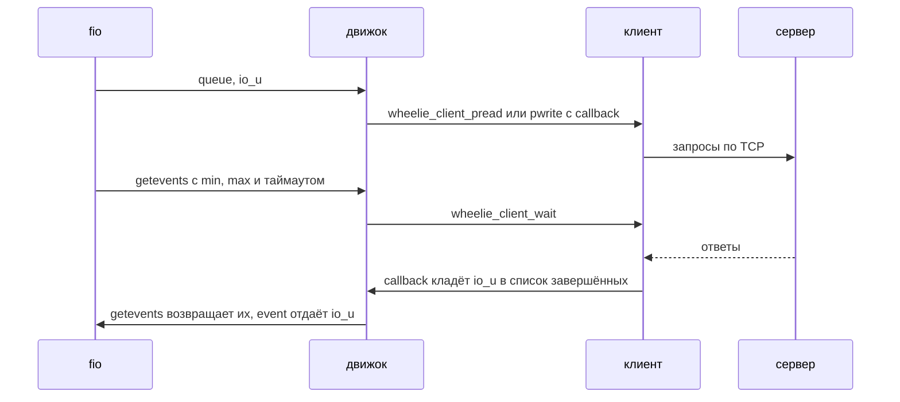

# Движок fio

`wheelie.so` — внешний движок [fio](https://github.com/axboe/fio): он гоняет
нагрузку fio через клиента wheelie (см. [design.md](design.md#клиент)) против
`wheelie-server`. Отдельный форк fio не нужен: fio загружает движок из файла.

## Сборка

Движок собирается против исходников fio, поэтому они лежат в подмодуле
`3rdparty/fio`, закреплённом на теге `fio-3.41`:

```
git submodule update --init --depth 1
./autogen.sh
./configure
make
```

Готовый движок — `fio/.libs/wheelie.so`. `configure` по умолчанию берёт
`3rdparty/fio`, если он на месте; `--with-fio=DIR` берёт исходники fio из
другого каталога, а `--without-fio` не собирает движок.

**Версия fio.** Движок можно загрузить только в fio той же версии, что и его
исходники, собранный с обычной для Linux конфигурацией: у fio нет стабильного
интерфейса для внешних движков, и несовпадающая сборка может упасть. Поэтому
тест пропускается, если `fio --version` не совпадает с версией исходников, а в
CI fio собирается из того же подмодуля:

```
cd 3rdparty/fio && ./configure && make
```

## Запуск

```
fio --name=randwrite --ioengine=external:$PWD/fio/.libs/wheelie.so \
    --filename=wheelie\://127.0.0.1\:39900 --wheelie_backend=uring \
    --size=1g --bs=4k --iodepth=16 --rw=randwrite
```

**Сервер задаётся в `filename`** — это его локация `wheelie://ХОСТ:ПОРТ`, где
хост — имя или IPv4-адрес, как `mds://хост:порт` у rawstor. fio режет `filename`
по двоеточиям (так он различает несколько файлов), поэтому двоеточия
экранируются обратной косой чертой, а fio убирает её до того, как имя дойдёт до
движка. В скрипте это `--filename="${location//:/\\:}"`. Если забыть, fio
получит три «файла» (`wheelie`, `//127.0.0.1`, `39900`), и движок на каждый
скажет, что имя должно быть локацией. Движок не разбирает имя сам, а отдаёт его
`wheelie_location_parse` из C-интерфейса клиента.

| Опция               | Смысл                                                              |
|---------------------|--------------------------------------------------------------------|
| `wheelie_backend`   | механизм ввода-вывода клиента: `libc`, `alibc` или `uring` (по умолчанию `uring`) |
| `wheelie_multishot` | принимать ответы одним multishot recv вместо recv на каждый кусок  |

Остальное берётся из обычных опций fio:

- `--iodepth` — сколько запросов клиент держит в полёте;
- `--numjobs` — сколько клиентов (по соединению на поток fio);
- `--sync=1` — запись с флагом `WHEELIE_FLAG_SYNC`, то есть данные на
  устройстве к моменту ответа;
- `--size` **обязателен**: у протокола нет способа спросить сервер о размере
  того, что он отдаёт.

Операций trim и sync у протокола нет: такой запрос движок завершает сразу, если
в полёте ничего нет.

## Как это устроено



`queue` только подаёт запрос, а всё, что требует прогресса реактора, происходит
в `getevents` через `wheelie_client_wait`. Колбэки складывают завершённые `io_u`
в массив, который `getevents` отдаёт fio, не перебирая все запросы. Таймаут
`getevents` движок считает сам, потому что `wheelie_client_wait` возвращает
только 0 или `-errno`.

## Тест

`make test` запускает `fio/tests/smoke.sh`: для клиентов всех бэкендов с
multishot и без, и против серверов разных бэкендов, fio пишет данные с
контрольной суммой `crc32c` и читает их обратно (`--verify_fatal=1`), то есть
то, что вернулось от сервера, обязано совпасть с записанным. Задания: запись с
проверкой, случайное чтение, запись с `--sync=1`, крупные блоки (1 МиБ), два
клиента сразу и глубина очереди 1.

Переменные: `FIO` (по умолчанию `fio`), `WHEELIE_FIO_REQUIRED` (если задана,
тест, который не может запуститься, считается упавшим, а не пропущенным).
