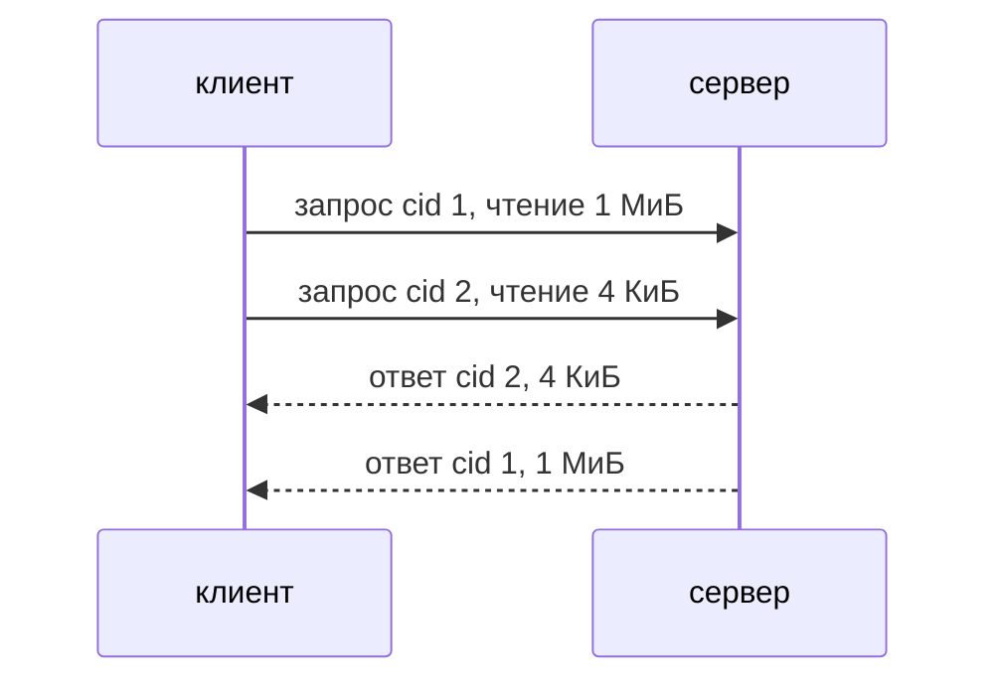

# Протокол wheelie

Блочный доступ по TCP, намеренно голый: нет magic-числа, версии и
аутентификации, а целые числа записаны в порядке байт хоста. Он соединяет
клиента и сервер, собранные вместе на машинах одного рода, чтобы сравнивать
механизмы ввода-вывода. Авторитетный источник —
`wheelie/include/wheelie/protocol.h`; этот документ описывает то же самое и
должен меняться вместе с ним.

## Запрос

Заголовок `WheelieRequestHeader` (26 байт, без выравнивания), и для записи
сразу за ним `size` байт данных. У чтения данных нет.

| Поле     | Размер | Смысл                                              |
|----------|--------|----------------------------------------------------|
| `cid`    | 8      | идентификатор запроса, выбирает клиент             |
| `offset` | 8      | смещение в байтах                                  |
| `size`   | 8      | сколько байт прочитать или записать                |
| `op`     | 1      | что сделать: `0` чтение, `1` запись                |
| `flags`  | 1      | как сделать: биты флагов, см. ниже                 |

```text
     +0         +1         +2         +3         +4         +5         +6         +7
     +---------------------------------------------------------------------------------+
  0  |                                   uint64_t cid                                  |
     +---------------------------------------------------------------------------------+
  8  |                                  uint64_t offset                                |
     +---------------------------------------------------------------------------------+
 16  |                                   uint64_t size                                 |
     +----------+----------+-----------------------------------------------------------+
 24  |    op    |  flags   | payload (size bytes, only for a write)...                 |
     +----------+----------+~~~~~~~~~~~~~~~~~~~~~~~~~~~~~~~~~~~~~~~~~~~~~~~~~~~~~~~~~~~+
```

Операция говорит, *что* сделать, а флаги — *как*. Флаг пока один:

| Флаг                | Бит | Для чего | Смысл                                              |
|---------------------|-----|----------|----------------------------------------------------|
| `WHEELIE_FLAG_SYNC` | 0   | запись   | к моменту ответа данные уже на устройстве          |

У сервера `WHEELIE_FLAG_SYNC` — это `RWF_DSYNC`. Без него ответ означает
только то, что запись принята, и данные могут оставаться в кэше устройства.
Неизвестный бит и флаг, который к операции не относится (например,
`WHEELIE_FLAG_SYNC` у чтения), закрывают соединение так же, как неизвестная
операция.

## Ответ

Заголовок `WheelieResponseHeader` (16 байт), и для успешного чтения сразу за ним
`res` байт данных.

| Поле  | Размер | Смысл                                                   |
|-------|--------|---------------------------------------------------------|
| `cid` | 8      | то же значение, что в запросе                           |
| `res` | 8      | сколько байт передано, либо `-errno` (знаковое число)   |

```text
     +0         +1         +2         +3         +4         +5         +6         +7
     +---------------------------------------------------------------------------------+
  0  |                                   uint64_t cid                                  |
     +---------------------------------------------------------------------------------+
  8  |                                    int64_t res                                  |
     +---------------------------------------------------------------------------------+
 16  | payload (res bytes, only for a read with res > 0)...                            |
     +~~~~~~~~~~~~~~~~~~~~~~~~~~~~~~~~~~~~~~~~~~~~~~~~~~~~~~~~~~~~~~~~~~~~~~~~~~~~~~~~+
```

`cid` нужен только затем, чтобы клиент с несколькими запросами в полёте на одном
соединении понял, к какому запросу относится ответ: ответы приходят в любом
порядке. Чтение за концом файла возвращает меньше байт, чем просили, или `0`.

Ответы приходят в любом порядке, поэтому и нужен `cid`:



## Границы

- Запрос не больше `WHEELIE_MAX_PAYLOAD_SIZE` (4 МиБ). Чтение больше этого
  получает ответ `-EMSGSIZE`, соединение продолжает работать: у чтения нет
  данных, которые можно потерять. Запись больше этого закрывает соединение:
  её данные уже в пути, и граница следующего запроса потеряна.
- Неизвестная операция и неподходящий флаг тоже закрывают соединение.
- Если сервер открыл файл с `O_DIRECT`, `offset` и `size` передаются ему как
  есть и должны быть выровнены так, как требует `O_DIRECT`. Что случится с
  невыровненным запросом, решает ядро: обычно это `-EINVAL` в ответе, но
  некоторые файловые системы такой запрос принимают.
